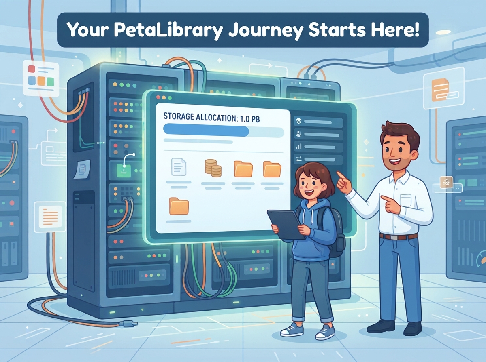

<!--

persistent: true 

icon: img/rc_logo.png

version: 0.0.1

tocDepth: 1


script:  https://cdn.jsdelivr.net/npm/mermaid@11.17.2/dist/mermaid.min.js


@onload
window.sendData = async function sendData({url='https://script.google.com/macros/s/AKfycbzoho4vFdv5J2e06WGnIOhRW5O0VPAMeMRK9t55oyiGXMJo8Z0OlSC-hIS2Ju30le3xUA/exec', username, email, course, question, value}) {
   //This script will transmit the user's credentials to the associated Google App Script & Google Sheet
   // TODO - Make sure to add new tabs to the training sheet (See Confluence Page for Link to Google Sheet)
     // <TRAINING_NAME>_SCORES - Tracks when a user correctly answers a question / knowledge check
     // <TRAINING_NAME>_VISITS - Tracks when a user visits a section of the training
   //You can instead create a new Google Sheet for tracking course interaction using the template linked in Confluence, but make sure to update url above to use the new Google Sheet's App Script
   
  //Only transmit data if a valid email has been given
  if(email.endsWith(".edu") || email.endsWith(".gov") || email.startsWith("anon_")){
    // We inject the captured selection into your JSON
    const payload = `{
        "username" : "${username}",
        "email" : "${email}", 
        "course" : "${course}",
        "question" : "${question}",
        "value" : "${value}"
    }`;

    try {
        const response = await fetch(url, {
            method: 'POST',
            mode: 'no-cors',
            headers: {
                'Content-Type': 'application/json',
            },
            body: payload,
        });
        
        // Note: With 'no-cors', we cannot read response.text(), but the request sends.
        console.log("Request sent successfully to Google Sheets");
        send.lia("true")
        return "Submission Successful"; 
    } catch (error) {
        console.error("Error:", error);
        alert(error)
        send.lia("Update Failed", [], false)
        return "Error sending data";
    }
  }
  else{
    console.log("Invalid Email")
  }
}

window.user_name="anon_" + Math.floor(Math.random() * 1000000);
window.user_email=window.user_name + "email.edu"

mermaid.initialize({ startOnLoad: false,  flowchart: { wrappingWidth: 400, subGraphTitleMargin: {"top": 15,"bottom": 0} } });


@end

@mermaid: @mermaid_(@uid,```@0```)

@mermaid_
<script run-once="true" modify="false" style="display:block; background: white">
async function draw () {
    const graphDefinition = `@1`;
    const { svg } = await mermaid.render('graphDiv_@0', graphDefinition);
    send.lia("HTML: "+svg);
    send.lia("LIA: stop")
};

draw()
"LIA: wait"
</script>
@end

@mermaid_eval: @mermaid_eval_(@uid)

@mermaid_eval_
<script>
async function draw () {
    const graphDefinition = `@input`;
    const { svg } = await mermaid.render('graphDiv_@0', graphDefinition);
    console.html(svg);
    send.lia("LIA: stop")
};

draw()
"LIA: wait"
</script>
@end


-->

# PetaLibrary Quick Start Guide

Welcome to the PetaLibrary! This interactive guide is designed for new Allocation Owners and their team members. It covers everything you need to know to successfully manage and interact with your PetaLibrary storage space.

<div style="width:45%; margin: 15px 2.5%; float:left;">

<!-- style="border:solid black 1px; border-radius: 15px;" -->

</div>

<div style="width:40%; border: solid black 1px; padding:10px; border-radius: 15px; float:left; margin: 15px 2.5%;" >

**Please enter your Research Computing account information: **

Do you have an existing RC account? 

<script input="radio" value="Select Yes or No" options="YES|NO">
  //If yes, reveal the username option
  if("@input" === "YES"){
    document.getElementById("username").hidden = false;
    "YES"
  }
  else if ("@input" === "NO"){
    document.getElementById("username").hidden = true;
    "NO"
  }
  else{
    "Select Yes or No"
  }
 
</script>

<div id="username" hidden>

Research Computing username: 

<script input="text" placeholder="buff1234" >
  let user_name_temp = "@input"
  if(user_name_temp){
    user_name = user_name_temp
    user_name_temp
  }
  else{
    "Enter username"
  }

</script>
</div>

Institutional email address: 

<script input="email" placeholder="e.g. Ralphie@colorado.edu" >
  let user_email_temp = "@input"

  if(user_email_temp){
    if(user_email_temp.endsWith(".edu") || user_email_temp.endsWith(".gov")){
      user_email = user_email_temp
    }
    else{
      document.getElementById("email_warning").innerHTML="WARNING - Please enter an institutional email (.edu) or government email (.gov)"
    }
    user_email_temp
  }
  else{
    "Enter institutional email"
  }

</script>

<div id="email_warning" style="color:red">

</div>

<br>


<script input="submit" default="Submit" style="display:block; text-align:center;"  >
  if(user_email.endsWith(".edu") || user_email.endsWith(".gov")){
    let currentDate = new Date();
    sendData({username: user_name, email: user_email, course:"PL_QUICKSTART_SCORES", question:"START", value: currentDate.toLocaleString()})
    "Information Saved"
  }
  else{
    "Please enter a valid institutional email"
  }
</script>


</div>

<div style="clear:both"></div>

> [!IMPORTANT] 
> We aim to make our online resources accessible to everyone. If you encounter any barriers in the materials contained in this tutorial, please report them through our [support request form](https://colorado.service-now.com/req_portal?id=ucb_sc_rc_form).

---

## Key Policies

<script hidden>
 let currentDate = new Date();
  sendData({username: user_name, email: user_email, course:"PL_QUICKSTART_VISITS", question:"KEY_POLICIES", value: currentDate.toLocaleString()})
  "LIA: wait"
</script>


Understanding PetaLibrary policies ensures your data remains secure and your team retains seamless access.

* **Acceptable Use** <br> The PetaLibrary allocation owner is responsible for ensuring that all use complies with the [PetaLibrary Terms of Service](https://www.colorado.edu/rc/resources/petalibrary/tos), [CURC User Policies](https://curc.readthedocs.io/en/latest/additional-resources/policies.html), and all relevant university policies.

* **Data Security and Compliance** <br> As outlined in the [Acceptable Data Storage Policy](https://curc.readthedocs.io/en/latest/additional-resources/policies.html#acceptable-data-storage-and-use-on-curc-resources),PetaLibrary allocations may not be used to store any data that is US government Classified nor any Controlled Unclassified Information. Additionally, [FCI data](https://curc.readthedocs.io/en/latest/additional-resources/policies.html#federal-contract-information-fci-and-petalibrary-storage-tiers) can only be stored on an "active" tier allocation. 

* **Backup Responsibility** <br> PetaLibrary is a storage system, but it is not a backup service. The PetaLibrary owner is responsible for maintaining secondary copies of critical, irreplaceable data.

* **Acknowledgements** <br> PetaLibrary is a university supported storage service. Any publications supported by the service must explicitly acknowledge and cite the [University of Colorado Boulder PetaLibrary](https://curc.readthedocs.io/en/latest/getting_started/acknowledge_curc_resources.html#acknowledging-petalibrary).


<div style="display: flex; align-items:center; padding:1em; border-top: dashed 1px; border-bottom: dashed 1px; " >

   

  <p style="margin-bottom:0;" > This tutorial provides a quick overview of CURC's PetaLibrary service. For more detailed information, please see [PetaLibrary's online documentation](https://curc.readthedocs.io/en/latest/petalibrary/index.html) </p>

</div>

### ✏ Knowledge Check

<div style="width:80%; border: solid black 1px; padding:10px; border-radius: 15px; float:left; margin: 15px 10%;" >

Who is the recommended owner of a PetaLibrary Allocation?

<!-- data-solution-button="off" -->
[( )] Lead Graduate Student
[(X)] Primary Investigator (PI)
[( )] Department's SpeedType Manager
[( )] No one, the "owner" is an optional role
<script>
let response = ""

if("@input" === "0" ){
  response = "<b>Not Quite.</b> <br> We recommend assigning Graduate Students and Lab Managers as Technical Contacts, which authorizes them to perform routine operations like modifying permissions or requesting quota increases but leaves final authority of the allocation with its owner. <br> <br>"
} else if ("@input" === "1") {
  response = "<b>Correct!</b> <br> Because only the allocation's owner may close an allocation or transfer ownership, we highly recommend assigning this role to the PI or another full time researcher. <br> <br>"
} else if("@input" === "2"){
  response = "<b>Not Quite.</b> <br> We recommend listing SpeedType managers as a Billing Contact, which ensures they are included in billing communications and authorizes them to handle common billing tasks (e.g. updating the allocation's SpeedType).  <br> <br>"
} else if("@input" === "3"){
  response = "<b>Not Quite.</b> <br> All allocations must have a designated owner. Only the Billing Contact and Technical Contact roles are optional. <br> <br>"
}

document.getElementById("roles_question_responses").innerHTML = response

if ("@input" === "1") {
  let currentDate = new Date();
  sendData({username: user_name, email: user_email, course:"PL_QUICKSTART_SCORES", question:"ROLES_OWNERSHIP", value: currentDate.toLocaleString()})
  send.lia("true")
} else {
  send.lia("")
}

"LIA: wait"
</script>

<div id="roles_question_responses"></div>

</div>
<div style="clear:both"></div>

---

## Allocation Tier Review

<script hidden>
 let currentDate = new Date();
  sendData({username: user_name, email: user_email, course:"PL_QUICKSTART_VISITS", question:"ALLOCATION_TIERS", value: currentDate.toLocaleString()})
  "LIA: wait"
</script>

PetaLibrary offers different storage tiers tailored to specific research data life cycles. Below you will find a brief overview of each tier and notes on their key features. For a more detailed comparison, please see [CURC's PetaLibrary documentation](https://curc.readthedocs.io/en/latest/petalibrary/allocation_types.html)

<br>

<details>
<summary>Active Tier</summary>

<div style="margin-left:5px;margin-right:5px">

**Active allocations** are the most performant and are configured for direct compute access from environments like Alpine and Blanca.

<!-- data-sortable="false" -->
| Feature | Value |
| -------- | ------ | 
| Raid Parity  | Double  |
| Object Limit | None    |
| Accessible from Compute Nodes | Yes, Alpine & Blanca | 
| SMB Mount Supported | Yes | 
| Data Compression | lz4 | 

</div>

> [!TIP] 
> *For computationally intensive workflows,* consider pairing an active tier allocation with `/scratch` and `$SLURM_SCRATCH`. This will provide you the long-term storage benefits of PetaLibrary with the increased speed of the scratch directories.  
> <br> <br> For more details, please see our online documentation on ["How to increase I/O performance"](https://curc.readthedocs.io/en/latest/compute/filesystems.html#how-to-increase-i-o-performance).

</details>

---

<details>
<summary>Archive Tier</summary>

<!--- Note: Margin is needed here because the detail's tag is set to hide overflow,
      which results in cropped content.  --->
<div style="margin-left:5px;margin-right:5px">

**Archive allocations** are configured to maximize data integrity over performance. They are not accessible from compute nodes, though they can be accessed interactively on login nodes.

<!-- data-sortable="false" -->
| Feature | Value |
| -------- | ------ | 
| Raid Parity  | Triple  |
| Object Limit | 10,000 per TB    |
| Accessible from Compute Nodes | No | 
| SMB Mount Supported | No | 
| Data Compression | zstd | 

</div>

</details>

---

<details>
<summary> Active+Archive Tier</summary>

<div style="margin-left:5px;margin-right:5px">

**Active+Archive allocations** automatically replicate your data from the Active PetaLibrary tier to the Archive tier. Rather than purchasing separate allocations and syncing data yourself, you can buy a single Active+Archive allocation. You get full access to the Active tier, and we handle replication to the Archive tier automatically.

<!-- data-sortable="false" -->
| Feature | Value |
| -------- | ------ | 
| Raid Parity  | Double  |
| Object Limit | None  |
| Accessible from Compute Nodes | Yes | 
| SMB Mount Supported | Yes | 
| Data Compression | lz4 | 

</div>

> [!IMPORTANT] Important Information on Replication 
> Active+Archive replication uses [ZFS snapshots](https://curc.readthedocs.io/en/latest/petalibrary/zfs_snapshots.html) to maintain a time-delayed mirror—not an incremental backup—of your Active tier. Because replication syncs snapshot additions and deletions from Active to Archive, aggressively pruning snapshots reduces them on both tiers. While snapshots preserve historical data incrementally, storing copies in two separate physical buildings protects against localized disasters like fire or water damage.

</details>

---

<details>
<summary>Archive+DR Tier</summary>

<div style="margin-left:5px;margin-right:5px">

**Archive+DR allocations** expand the archive tier's services by automatically backing up snapshots to an offsite location monthly. Backup and restoration of this data are managed entirely by CURC staff.

<!-- data-sortable="false" -->
| Feature | Value |
| -------- | ------ | 
| Raid Parity  | Double  |
| Object Limit | None    |
| Accessible from Compute Nodes | Yes, Alpine & Blanca | 
| SMB Mount Supported | Yes | 
| Data Compression | lz4 | 

</div>

</details>


> [!WARNING]
> Please remember that all PetaLibrary allocations are considered a single copy of your research data. Irreplaceable data must be backed up to a storage device or service outside of PetaLibrary. 

### ✏ Knowledge Check

<div style="width:80%; border: solid black 1px; padding:10px; border-radius: 15px; float:left; margin: 15px 10%;" >

Andy is running climate models on the Alpine cluster to study how deforestation affects local climates. Which PetaLibrary tiers could he choose to support his data storage and computing needs? (Select all that apply)

<!-- data-solution-button="off" -->
[[X]] Active
[[ ]] Archive
[[X]] Active+Archive
[[ ]] Archive+DR
<script>
let response = ""
let check = 0

//  Neutral Net
if (@input[0] == "1") {
  response += "<b>Active... - Correct!</b> <br> Active allocations are accessible from compute nodes, which make them a great choice for storing research data that will be analyzed and/or processed on the Alpine and Blanca clusters. <br> <br>"
  check+=1
} 

//Spreadsheet 
if (@input[1]  == "1") {
  response += "<b> Archive... - Not Quite.</b>  <br> Compute nodes cannot directly access archive allocations. This means jobs running on the Alpine and Blanca clusters cannot read data from or write results to an archive allocation.  <br> <br>"
  check-=1
} 

// CFD Simulation
if (@input[2] == "1") {
  response += "<b>Active+Archive... - Correct!</b> <br> Active allocations are accessible from compute nodes, which make them a great choice for storing research data that will be analyzed and/or processed on the Alpine and Blanca clusters. <br> <br>"
  check+=1
} 

// Hosting a website
if (@input[3] == "1") {
  response += "<b> Archive+DR... - Not Quite.</b>  <br> The 'DR', or disaster recovery, part of Archive+DR, only provides offsite backups of an archive allocation. It does not provide access to the Alpine or Blanca clusters.  <br> <br>"
  check-=1
} 

document.getElementById("tiers_question_responses").innerHTML = response

if (check==2) {
  let currentDate = new Date();
  sendData({username: user_name, email: user_email, course:"PL_QUICKSTART_SCORES", question:"TIER_COMPUTE_ACCESS", value: currentDate.toLocaleString()})
  send.lia("true")
} else {
  send.lia("")
}

"LIA: wait"
</script>

<div id="tiers_question_responses"></div>

</div>
<div style="clear:both"></div>

## Common Data Operations

<script hidden>
 let currentDate = new Date();
  sendData({username: user_name, email: user_email, course:"PL_QUICKSTART_VISITS", question:"DATA_OPERATIONS", value: currentDate.toLocaleString()})
  "LIA: wait"
</script>

Once you have access to a PetaLibrary allocation, you will need to start working on managing your data operations. This section provides a quick overview for how you can transfer data to-and-from your allocation, share data with collaborators, and how to restore your data from snapshots.

<br>

<details>
<summary>Transferring Data </summary>

<div style="margin-left:5px;margin-right:5px"> 

* **Globus:** The recommended method for transferring large datasets to and from PetaLibrary, especially when collaborating across institutions. <br> [Globus Documentation](https://curc.readthedocs.io/en/latest/compute/data-transfer.html#globus) 
* **Command-Line Tools:** Ideal for smaller files or direct transfers through the data transfer nodes (dtns). <br> [RClone Documentation for PetaLibrary](https://curc.readthedocs.io/en/latest/petalibrary/data_transfer/rclone.html) <br> [Documentation for Command-Line Tools](https://curc.readthedocs.io/en/latest/compute/data-transfer.html#secure-copy-scp) 
* **SMB Mount:** Allows mounting your active PetaLibrary directory directly to your desktop or laptop for interactive file management. <br> [SMB Documentation](https://curc.readthedocs.io/en/latest/petalibrary/data_transfer/mounting.html)

</div>

> [!NOTE] Automated Data Transfers
> Research groups that collect data from sensors and lab instruments often need automated workflows to upload files to PetaLibrary as they are generated. You can configure these automated transfers using passwordless SSH key authentication. <br> [Automated Data Transfers Documentation](https://curc.readthedocs.io/en/latest/compute/data-transfer.html#automated-scp-and-rsync) 

</details>

---

<details>
<summary>Sharing Data </summary>

<div style="margin-left:5px;margin-right:5px">

*How* a PetaLibrary allocation's data is shared depends primarily on *who* it is being shared with. Specifically, whether the collaborator is internal or external to Research Computing. 

**Internal Collaborators** 

* **Definition:** Anyone who is able to request a Research Computing account. This includes researchers from the University of Colorado Boulder, University of Colorado Anschutz, and any institution in the [Rocky Mountain Advanced Computing Consortium (RMACC)](https://www.colorado.edu/partnerships/rmacc/about). 
* **Sharing Method: ** Submit a help ticket with the User Support Team and request that the internal collaborator be added to the allocation's Linux group. All files and directories shared with the group will be accessible to the collaborator. See [Workspace Sharing](https://curc.readthedocs.io/en/latest/compute/filesystems.html#workspace-sharing) for additional information on Linux groups.<br> 

**External Collaborators**

* **Definition:** This encompasses any researcher who is unable to acquire a Research Computing account. 
* **Sharing Method:** Globus Guest Collections (formerly known as “Shared Endpoints”) enable PetaLibrary customers to share a given folder in a PetaLibrary active or archive allocation with anyone – regardless of whether they have a CURC account – simply by using their email address. Additional information can be found in the [Globus Guest Collection Guide](https://curc.readthedocs.io/en/latest/petalibrary/data_transfer/guestcollection.html).


</div>

</details>

---

<details>
<summary>Restoring Data </summary>

<div style="margin-left:5px;margin-right:5px">

PetaLibrary maintains automated snapshots of an allocation's data. This enables users to recover data that they have unintentionally deleted or modified, during a specified retention period. Every PetaLibrary allocation has snapshots enabled by default.

**Key Details**

 * **Impact on Storage:**  Snapshots count towards an allocation's storage quota. Removing a file will only free storage space if no snapshots reference the file. 
* **Retention Period:** Snapshots, by default, are created every 15 minutes and last for 7 days. This means a file can be recovered up to 7 days after it has been deleted. Full details can be found in the [default snapshot schedule page](https://curc.readthedocs.io/en/latest/petalibrary/zfs_snapshots.html#default-snapshot-schedule).  
 * **Restoring Snapshot Files:** A snapshot's files are stored in a read-only, time-stamped subdirectory of an allocation. You can find instructions for viewing snapshots in the [data recovery guide](https://curc.readthedocs.io/en/latest/petalibrary/zfs_snapshots.html#data-recovery).


</div>

</details>

### ✏ Knowledge Check

<div style="width:80%; border: solid black 1px; padding:10px; border-radius: 15px; float:left; margin: 15px 10%;" >

Meredith needs to upload a research corpus that is roughly 55GB in size to PetaLibrary. What data transfer tool does CURC recommend they use?

<!-- data-solution-button="off" -->
[( )] Open OnDemand's File Browser
[( )] CU Boulder's Large File Transfer Service
[(X)] Globus
[( )] None of the above
<script>
let response = ""

if("@input" === "0" ){
  response = "<b>Not Quite.</b> <br> While Open OnDemand does include a file browser, it is intended to support relatively small file transfers only, think text files or scripts of code that are only a few KB or MB in size. <br> <br>"
} else if ("@input" === "1") {
  response = "<b>Note Quite.</b> <br> CU Boulder's Large File Transfer Service, known called Secure File Transfer, is a niche service intended to support the secure transfer of large files between two parties. It is not connected to PetaLibrary nor does it support data transfers to PetaLibrary. <br> <br>"
} else if("@input" === "2"){
  response = "<b>Correct.</b> <br> While a variety of tools can be used, often the most robust option for Research Computing users is Globus. If you are new to managing data transfers, we highly recommend you start with Globus.  <br> <br>"
} else if("@input" === "3"){
  response = "<b>Not Quite.</b> <br> A valid data transfer tool is provided. Please try again. <br> <br>"
}

document.getElementById("data_transfer_question_responses").innerHTML = response

if ("@input" === "2") {
  let currentDate = new Date();
  sendData({username: user_name, email: user_email, course:"PL_QUICKSTART_SCORES", question:"DATA_TRANSFER", value: currentDate.toLocaleString()})
  send.lia("true")
} else {
  send.lia("")
}

"LIA: wait"
</script>

<div id="data_transfer_question_responses"></div>

</div>
<div style="clear:both"></div>


## Monitoring Data Usage

<script hidden>
 let currentDate = new Date();
  sendData({username: user_name, email: user_email, course:"PL_QUICKSTART_VISITS", question:"MONITORING_USAGE", value: currentDate.toLocaleString()})
  "LIA: wait"
</script>

The two primary methods for checking an allocation's storage usage are the `.cstats` report (exclusive to Active and Active+Archive tier allocations) or running the `df` terminal command. Examples and additional information for each are provided below. 

<br>

<details>
<summary>**View example .cstats report**</summary>

For Active and Active+Archive allocations, the most comprehensive and accurate information on data usage can be found in the *.cstats* file. This file is located in the allocation's base directory and is updated on an hourly basis.  

```
$ cat /pl/active/example_allocation/.cstats

---------------------------------------------------

Date/Time: 2026-11-18 03:00:06 PM

Allocation Name: pla-enc9/active/example_allocation

Mountpoint: /pl/active/example_allocation

---------------------------------------------------
Overall Statistics:

Allocated Space: 5.0T

Available Space: 2.5T

Used Space: 2.6T

	Used by data:		2.6T
	Used by snapshot:	250M

---------------------------------------------------
User Statistics:

	Username          	UsedData	UsedObjects
	ralp1234          	235G    	860
	colo0001            2.25T   	158002
---------------------------------------------------
```
> [!NOTE] Empty .cstats File
> If the *.cstats* file ever appears empty, then the allocation is likely full. You can verify this by running the `df` command.

</details>

---

<details>
<summary>**Check disk usage with df**</summary>


We recommend using the `df` command, also known as "disk free", to check an allocation's data usage. This command can be run from any login node and can be used with any PetaLibrary tier. 

``` 
#Format:  df -H /pl/<tier>/<allocation_name>

$ df -H /pl/active/curc

Filesystem                    Size  Used Avail Use% Mounted on
pla-enc9:/srv/pl/active/curc  4.6T  2.4T  2.2T  52% /pl/active/curc

```

</details>


### ✏ Knowledge Check

{{0}}
<div style="width:80%; border: solid black 1px; padding:10px; border-radius: 15px; float:left; margin: 15px 10%;" >

In checking his lab's allocation usage, Zane notices that the .cstats file is completely blank. What does this likely mean?

<!-- data-solution-button="off" -->
[( )] The .cstats file has expired.
[( )] Zane's access to the allocation has been revoked.
[( )] Someone accidentally deleted the .cstats file's content.
[(X)] The allocation is likely full.
<script>
let response = ""

if("@input" === "0" ){
  response = "<b>Not Quite.</b> <br> While the .cstats file never expires, its hourly updates will fail if your allocation runs out of space to save the updated file.  <br> <br>"
} else if ("@input" === "1") {
  response = "<b>Note Quite.</b> <br> While the allocation owner or approved contacts can request changes to user access, adding or removing someone will not affect any files or data stored in the allocation. <br> <br>"
} else if("@input" === "2"){
  response = "<b>Note Quite.</b> <br> The .cstats file is a read-only file managed by the system. This means individual lab members cannot edit or delete its contents.  <br> <br>"
} else if("@input" === "3"){
  response = "<b>Correct!</b> <br> While the .cstats file is fairly small, only a few KB in size, if an allocation is full then the system will be unable to properly update .cstats and result in an empty file. If this happens, please reach out to the User Support Team for guidance through the <a href='https://colorado.service-now.com/req_portal?id=ucb_sc_rc_form'>online help form</a>. <br> <br>"
}

document.getElementById("data_usage_question_responses").innerHTML = response

if ("@input" === "3") {
  let currentDate = new Date();
  sendData({username: user_name, email: user_email, course:"PL_QUICKSTART_SCORES", question:"DATA_USAGE", value: currentDate.toLocaleString()})
  send.lia("true")
} else {
  send.lia("")
}

"LIA: wait"
</script>

<div id="data_usage_question_responses"></div>

</div>
<div style="clear:both"></div>

{{1}}
<div style="width:80%; border: solid black 1px; padding:10px; border-radius: 15px; float:left; margin: 15px 10%;" >

After determining the lab's allocation is full, Zane decides to free up some storage space by deleting unused data from old experiments. Unfortunately, even after deleting the unused data, the allocation still seems to be listed as full. What might be the problem?

<!-- data-solution-button="off" -->
[( )] Only the technical contact for an allocation may permanently delete files.
[(X)] The deleted data is still being retained in .snapshots, which hold files for up to 7 days and count toward the allocation's storage limit.
[( )] Once an allocation's storage quota has been reached, the system will list it as full until the next billing cycle.
[( )] None of the above  
<script>
let response = ""

if("@input" === "0" ){
  response = "<b>Not Quite.</b> <br> As long as appropriate file permissions are set, any member of a PetaLibrary allocation may create, edit, or even delete files. <br> <br>"
} else if ("@input" === "1") {
  response = "<b>Correct!</b> <br> PetaLibrary's automated .snapshots retain deleted or modified data for up to 7 days so it can be recovered if needed. Because retained snapshots consume a portion of an allocation's storage space, deleting files will not immediately free up space until those snapshots rotate out. <br> <br> If freeing the storage is urgent, consider increasing the allocation's size or submitting a help ticket to the user support team. <br> <br>"
} else if("@input" === "2"){
  response = "<b>Note Quite.</b> <br> The annual renewal period (aligned with the university's fiscal year) applies strictly to billing; it does not reset or alter how the system reports your allocation's data usage. <br> <br>"
} else if("@input" === "3"){
  response = "<b>Note Quite. Try again</b> <br>"
}

document.getElementById("data_snapshot_question_responses").innerHTML = response

if ("@input" === "1") {
  let currentDate = new Date();
  sendData({username: user_name, email: user_email, course:"PL_QUICKSTART_SCORES", question:"DATA_SNAPSHOTS", value: currentDate.toLocaleString()})
  send.lia("true")
} else {
  send.lia("")
}

"LIA: wait"
</script>

<div id="data_snapshot_question_responses"></div>

</div>
<div style="clear:both"></div>


## Managing an Allocation

<script hidden>
 let currentDate = new Date();
  sendData({username: user_name, email: user_email, course:"PL_QUICKSTART_VISITS", question:"MANAGING_ALLOC", value: currentDate.toLocaleString()})
  "LIA: wait"
</script>

The owner, or their designated contacts, can request changes to their allocation by submitting a [help request](https://colorado.service-now.com/req_portal?id=ucb_sc_rc_form) to the User Support Team. Below you will find additional information for common requests related to changing an allocation's size, its SpeedType, and its owner.

<br>

<details>
<summary>Changing an allocation's size</summary>

<div style="margin-left:5px;margin-right:5px">

While PetaLibrary allocations are created with an initial size, that capacity can be adjusted as a research lab's needs evolve. Keep the following guidelines in mind when planning changes to an allocation's storage:

* Size Limits: Allocations must be at least 1 TB and no larger than 200 TB.
* Processing Time: Size changes are not instantaneous. Some adjustments require migrating the allocation to a different storage enclosure, which takes time to complete.

To avoid delays, choose an initial size that accounts for both current data needs and automated snapshot usage.

</div>
</details>

---

<details>
<summary>Updating an allocation's SpeedType </summary>

*For Colorado University system users,* PetaLibrary charges are billed to a university SpeedType. The listed SpeedType for a PetaLibrary allocation can be changed at any time. 

*For users external to the Colorado University system,* PetaLibrary charges must be paid with a check. 

> **Fiscal Year Renewals:** Allocations are renewed at the end of each University Fiscal Year (July 1). Invoices are sent to the Owner and Billing Contact. Always verify that billing information and the listed SpeedType are correct prior to renewal.

</details>

---

<details>
<summary>Changing Allocation Ownership</summary>

Only the owner of an allocation may transfer ownership to another eligible faculty member or researcher. 

In the event a former PetaLibrary owner is not available to designate a new owner, the owner of the SpeedType that was last used to pay for a PetaLibrary allocation may designate a new owner.

</details>

---

<details>
<summary>Offboarding Collaborators and Managing Access</summary>

<div style="margin-left:5px;margin-right:5px">

In the event a collaborator or student leaves the university, we recommend the considering the following actions:
* **Group File Permissions**: The departee should updated group file permissions (e.g. `chmod g+w <file_name>`). This ensures others can use the files they have created after they have left. If the departee is unable to modify group file permissions, please contact the User Support Team for assistance.
* **PetaLibrary Access:** To rescinded the departee's access to the allocation, please submit a help ticket with the User Support Team.
* **POI Accounts:** If an external or departed collaborator still requires ongoing access, consider establishing a University Person of Interest (POI) account. Additional information on POI accounts can be found in [OIT's online documentation](https://oit.colorado.edu/accounts/persons-of-interest).

</div>

</details>

### ✏ Knowledge Check

<div style="width:80%; border: solid black 1px; padding:10px; border-radius: 15px; float:left; margin: 15px 10%;" >

A research lab's PetaLibrary allocation is running low on storage, so the owner submits a help request to increase its capacity from 50 TB to 150 TB. According to the documentation, what should the owner expect?

<!-- data-solution-button="off" -->
[( )] Allocation sizes are permanently locked after creation, so the owner must request a second allocation instead.
[( )] The request cannot be fulfilled because it is too large. PetaLibrary allocations have a maximum size limit of 100 TB.
[(X)] The request falls within the PetaLibrary size limit, but the change will not be instantaneous because it may require migrating the allocation to a different storage enclosure.
<script>
let response = ""

if("@input" === "0" ){
  response = "<b>Not Quite.</b> <br> An allocation's size can be changed after it is created. This includes both increases and decreases in size. <br> <br>"
} else if ("@input" === "1") {
  response = "<b>Note Quite.</b> <br> PetaLibrary allocations have a maximum size of 200TB and a minimum size of 1TB. <br> <br>"
} else if("@input" === "2"){
  response = "<b>Correct!</b> <br> Because PetaLibrary allocations reside on a shared storage system, changing an allocation's size may require additional backend work to maintain an optimal system configuration. If extra work is needed, the User Support Team will notify you and keep you updated on the expected timeline before your request is fulfilled. <br> <br>"
} 

document.getElementById("manage_alloc_question_responses").innerHTML = response

if ("@input" === "2") {
  let currentDate = new Date();
  sendData({username: user_name, email: user_email, course:"PL_QUICKSTART_SCORES", question:"MANAGE_ALLOC", value: currentDate.toLocaleString()})
  send.lia("true")
} else {
  send.lia("")
}

"LIA: wait"
</script>

<div id="manage_alloc_question_responses"></div>

</div>
<div style="clear:both"></div>

## Conclusion

<script hidden>
 let currentDate = new Date();
  sendData({username: user_name, email: user_email, course:"PL_QUICKSTART_VISITS", question:"CONCLUSION", value: currentDate.toLocaleString()})
  "LIA: wait"
</script>


**Congratulations! You have completed CURC's PetaLibrary Quick Start Guide!**

If you have specific questions about CURC resources, please fill out our [support request form](https://colorado.service-now.com/req_portal?id=ucb_sc_rc_form).

To learn more about Research Computing, consider:

* Reading the [Online Documentation](https://curc.readthedocs.io/en/latest/getting_started/navigating_docs.html).
* Attending a [Workshop Training Session or Consult Hours](https://curc.readthedocs.io/en/latest/getting_started/trainings_and_consults/index.html).

--- 


<div style="width:40%; border: solid black 1px; padding:10px; border-radius: 15px; margin: 0 auto;" >

Please let us know how useful you found this online training: 

  [(2)] Very useful
  [(1)] Somewhat useful
  [(0)] Neutral 
  [(-1)] Not so useful
  [(-2)] Not very useful
<script>
  let choices = @input;
  for (const [key, value] of Object.entries(choices)) {
    if(value === 1){
      sendData({username: user_name, email: user_email, course:"PL_QUICKSTART_SCORES", question:"REVIEW_SCORE", value: key })
      send.lia("Feedback Sent", [], false)
      break;
    }
  }

</script>

</div>

<br>

<div style="width:40%; border: solid black 1px; padding:10px; border-radius: 15px; margin: 0 auto;" >

Please provide any comments you would like to share with us on this course: 

[[___ ___ ___ ___]]
<script>
  let feedback= `@input`
  feedback = feedback.replace(/(\r\n|\n|\r)/g, "_"); //Google Script wont accept breaks, must replace with "_" to ensure the data is received/saved.
  sendData({username: user_name, email: user_email, course:"PL_QUICKSTART_SCORES", question:"COMMENTS", value: feedback})
  send.lia("Feedback Sent", [], false)
  "LIA: wait"
</script>


</div>

<div style="clear:both"></div>